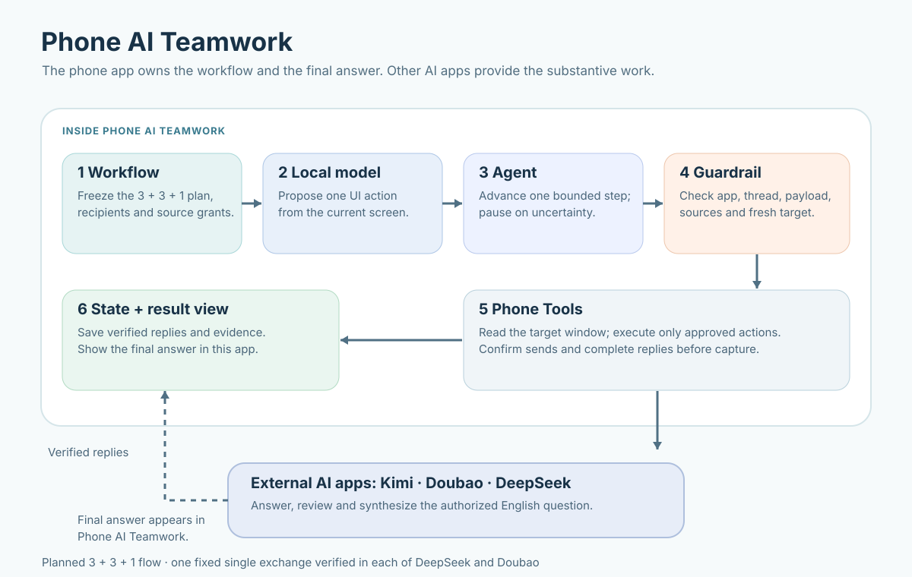

# Phone AI Teamwork — Experimental Android POC

Phone AI Teamwork explores whether a small model running on an Android phone can inspect accessibility nodes and optional screenshots, propose limited UI actions, and help a local Agent coordinate AI apps such as Kimi, Doubao, and DeepSeek. The native Android implementation follows the [v0.3 design specification](docs/design-v0.3.md).

The on-device model identifies UI elements and proposes actions. The Agent manages the workflow and decides when to stop. Deterministic code prepares message payloads and verifies execution evidence. External AI apps answer, review, or synthesize. Each layer records its own results so failures can be attributed to model decisions, phone operations, state recovery, or AI responses.

**This project is still validating core capabilities.** One fixed public English prompt completed a real single exchange in each of DeepSeek and Doubao: the local model selected the input and send controls, the Agent and Guardrail authorized one send per app, and Phone AI Teamwork verified, saved, and displayed each complete response. Kimi has staged the fixed public prompt with exact readback and stopped before send. Three-app collaboration and the five-case demonstration have not yet passed. See the [DeepSeek evidence](docs/single-exchange-experiments/02-deepseek-verified-2026-10-29.md), [Doubao evidence](docs/single-exchange-experiments/04-doubao-verified-2026-10-29.md), [Kimi staging evidence](docs/single-exchange-experiments/03-kimi-doubao-staged-2026-10-29.md), and [POC status](docs/poc-status.md).



Start with the [planning and result flow](docs/planning-and-result-flow.md), [five public English questions](scripts/step-lab/scenarios.json), [step-based test scripts](docs/step-lab.md), [responsibility contracts](docs/capability-contracts.md), [unverified capabilities and deferred features](docs/capability-gates.md), and [offline replay boundaries](docs/offline-replay.md). Some linked project notes are currently in Chinese.

## What works today

- Inspect responsibility boundaries, available evidence, and features awaiting validation. There is no unlock switch for unverified features.
- In debug builds, run versioned, read-only UI localization scripts against the local model. Results and low-resolution thumbnails go into the Git-ignored `captures/` directory.
- Save tasks, participants, and sharing scope. Generate one-, two-, or three-participant steps from the same Recipe. The default three-app Recipe has seven steps: 3 + 3 + 1.
- Preview the complete generated payload for the first step, its provenance, and the journal. Pause, cancel, or delete local records.
- Once the actual package names are configured and the user enables the accessibility service, start a 30-second, one-shot UI tree observation for Kimi, Doubao, or DeepSeek. On Android 14+, request a screenshot of the current window. These observations are not written to disk and do not scan other apps.
- Import a local GGUF model and matching mmproj file, verify user-provided SHA-256 hashes, and store source, license, and quantization metadata.
- Call one llama.cpp model instance through in-process JNI for constrained proposals based on a UI tree or a UI tree plus screenshot. Record load time, step time, peak PSS sampled every 250 ms, and parse status. One on-device run localized a clear input field; general automation, stability, and success rate remain unverified.
- Run one fixed public DeepSeek single-exchange debug path with exact input readback, model-selected send control, a persisted effect intent, two-observation reply verification, and Room capture. The verified response appears on the task page in Phone AI Teamwork.
- Stage the same fixed public question in prepared Kimi and Doubao conversations, with on-device model localization and exact draft readback. Kimi stops before sending.
- Run the fixed public Doubao single-exchange path with one model-selected send, two-observation role/completion verification, Room capture, and display in Phone AI Teamwork.

## Current limits

Normal tasks do not automatically navigate, send messages, capture answers, or resume threads. Development-only paths accept one fixed public question: DeepSeek and Doubao each have one verified single exchange; Kimi has one verified input staging and stops before send. They do not accept arbitrary outgoing text. `AppHints` has no generally validated version. See the [single-app exchange status](docs/single-exchange.md).

This is an experimental starting point with real storage, observation, a local model interface, and two narrow, version-pinned send-and-capture adapters. Three-app navigation, conversation return, seven-step orchestration, five repeatable cases, and privacy-reviewed videos remain incomplete.

## Build

Development requirements: JDK 17+ (Android Studio JBR 21 used locally), Android SDK 36, Gradle 8.14.3, AGP 8.13.0, Kotlin 2.1.20, and Room 2.7.2. Minimum Android version: Android 11 / API 30. Native target: arm64-v8a.

```bash
# Observation and task UI build, without an inference library.
./gradlew :app:assembleDebug :app:verifyReleasePermissions -PlocalModel=false

# Full local backend: first prepare the pinned source and SDK NDK/CMake.
bash scripts/bootstrap-native.sh
# If the source archive downloads slowly, use per-file hash-verified downloads:
# python3 scripts/fetch-native-source.py
# Install NDK 27.2.12479018 and CMake 3.22.1 through Android Studio SDK Manager.
./gradlew :app:assembleDebug :app:verifyReleasePermissions
```

The default package names observed on the test device are `com.moonshot.kimichat`, `com.larus.nova`, and `com.deepseek.chat`; see the [device observations](docs/device-observations-2026-09-22.json). For other installation channels, obtain the actual package names using the [device check guide](docs/device-check.md) and override them with `-PkimiPackage=... -PdoubaoPackage=... -PdeepseekPackage=...`. The app does not enumerate every installed package.

For development builds on slower networks, `-PchinaMirror=true` selects Aliyun mirrors for Google, Maven Central, and Gradle plugins. Official repositories remain the default. This mirror setting does not affect the phone runtime.

Local model support is enabled by default. `-PlocalModel=false` is only for checking the development toolchain and does not constitute validation of local inference.

## Six responsibilities

The [capability contracts](docs/capability-contracts.md) define each component's inputs, outputs, permissions, implementation status, capability IDs, and failure ownership. They also distinguish the local control model from the business roles of the three external AI apps.

| Module | Responsibility |
| --- | --- |
| `workflow` | Fixed Recipes, frozen provenance, and program-generated payload templates |
| `agent` | One coordination loop and a limited proposal protocol |
| `model` | One model instance, local JNI inference, and structured parsing |
| `phone` | User-initiated observation, the single Guardrail execution entry point, and constrained staging |
| `state` | Room transactions, task snapshots, journal, and paused recovery |
| `guardrail` | Deterministic checks of task, app, thread, target, provenance, and recipient |

Task snapshots include messages and payloads. The initial database has `tasks` and `journal` Room tables. The database is the sole source of truth; JSONL is not used as a second state store.

## Data boundaries

Local recognition and coordination state require no additional cloud server. Future collaboration, when enabled, will send authorized task content to the selected AI apps under their respective service terms.

The manifest has no `INTERNET` or `QUERY_ALL_PACKAGES` permission, and the merged release manifest is checked during the build. App data is excluded from cloud backup and device transfer. Screenshots and UI trees stay in memory. Model diagnostic files retain timing, memory, action enum, and node path, but not screen content or raw model output. Tasks and imported model files are kept in private app storage.

The lack of a network permission does not guarantee that data shared with another app cannot leave the device. Deleting a local task does not delete third-party chats. The user enables accessibility access, obtains model files, and confirms the model license.

More details: [POC status](docs/poc-status.md), [local model experiment](docs/local-model.md), [threat model](docs/threat-model.md), and [verification plan](docs/verification-plan.md).

## License

New project code is MIT-licensed; see [LICENSE](LICENSE). llama.cpp and other third-party dependencies retain their own licenses. Model weights are not distributed with this repository. The target apps' terms and distribution requirements need review before public release.
